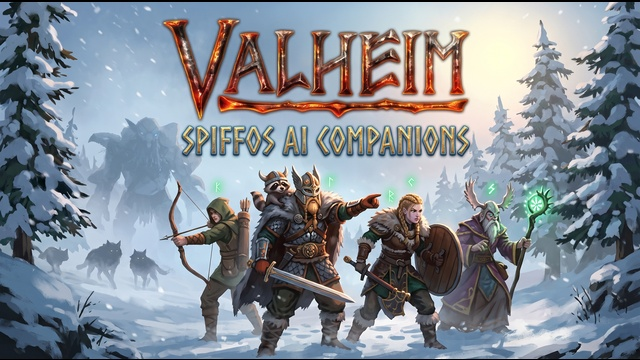

# Spiffo's Valheim AI Companions

[English](README.md) · [Último release](https://github.com/NotUrSpiffo/Spiffos-AI-Companions/releases/latest) · en `main` el plugin es `0.26.2`

<p>
  
</p>

Habla con los compañeros de Valheim en **español o inglés**, por texto o con el micrófono, y dales encargos en lenguaje normal. El servicio de IA previsto es la aplicación de escritorio **Player2**. Offline Companions Reborn **1.5.8** ya va dentro de `SpiffoAiCompanions.dll`: no instales ese mod otra vez.

Esta página describe ajustes y límites de este repositorio. No es un informe de pruebas en partida. Hay una [ficha en Player2](https://player2.game/games/jorge-roman/game-f3f99636) enviada y comunicada como en revisión. Esa ficha no es una aprobación.

<a id="contents"></a>

## Contenido

- [Características](#features)
- [Cinco por mundo, cuatro por orden](#companions)
- [Inicio rápido](#quick-start)
- [Requisitos](#requirements)
- [Instalación](#install)
- [Configuración de Player2](#player2)
- [Voz](#voice)
- [Comprobar la conexión](#check)
- [Otros proveedores de IA](#other-providers)
- [Idioma](#language)
- [Controles](#controls)
- [Configuración del mod](#config)
- [Solución de problemas](#troubleshooting)
- [Release](#release)
- [Créditos](#credits)

<a id="features"></a>

## ✨ Características

| Qué incluye | Dónde está definido |
| --- | --- |
| Chat con quien miras, o con el más cercano | `TalkKey` por defecto `Y`; chat del juego si `TalkInGameChat` está activo |
| Pulsar para hablar, mediante la app de Player2 | `[Voz]`: mantener `H`, máximo 15 segundos |
| Hasta 5 compañeros en un mundo | Constante fija `MaxCompanionsPerWorld` en `BehaviorOverrides.cs`. No es una clave de config. Ver [compañeros](#companions) |
| Una tarea distinta para cada compañero nombrado en una orden | Como máximo 4 destinatarios (`Recipients.MaxPerOrder`). `AllowActions` activo por defecto |
| Interfaz, indicaciones y respuestas en español e inglés | `[Personaje] Language` por defecto `Auto` |
| Memoria entre sesiones | `[Memoria] Enabled` activo; se guarda sin cifrar en la carpeta de config del mod |
| Comentarios breves ante jefes, biomas, muertes, asaltos y hechos parecidos | `[Reacciones]` activo; cada comentario es una petición a la IA |
| Modo autónomo opcional para todos los compañeros | `/autonomia`; el modo por defecto es `Normal` (solo hacen lo que pides) |
| Movimiento, combate y trabajos de Reborn dentro de esta DLL | Versión del plugin Reborn `1.5.8`; no instales una segunda copia |
| Unas frases exactas siguen funcionando sin IA | `ven` / `sigueme`, `para`, `quedate`, más los comandos con barra de abajo |

En el editor de personaje hay seis personalidades: **Vieja guardia**, **Aprendiz**, **Exploración**, **Caza**, **Oficio** y **Bromas**. Si `[Personaje] Personality` está vacío, cada compañero sin instrucciones propias recibe uno de esos perfiles. Las inclinaciones del editor son **Automática**, **Ninguna**, **Oficio**, **Exploración**, **Caza** y **Recolección**. Automática sigue el perfil y no anula una orden tuya.

En `main`, el plugin **0.26.2** cambia además estos comportamientos de Reborn en `codigo/src/BehaviorOverrides.cs`, `codigo/src/SeatSync.cs` y `codigo/src/StorageSortPatches.cs`. Lo que cambió está en [RELEASE_NOTES.md](RELEASE_NOTES.md).

- **Picar:** se deja una roca de piedra o de mineral, o una sección, cuando el código decide que solo se llega nadando. Si faltan `MHR_Water.WouldSwim` o `MHR_GatherRules.AllowTarget`, el registro avisa de que ese filtro no está disponible.
- **Pelear con una herramienta en la mano:** si el objeto elegido es una caña de pescar, tiene daño de pico o es una herramienta, el mod prueba un arma cuerpo a cuerpo, luego un arco, y si no, la desequipa. Si faltan los métodos de combate de Reborn, el registro avisa de que el cambio no está disponible.
- **Atascado trabajando (0.25.7):** si un compañero que tala o pica pasa **20** segundos sin dar un golpe, sin acertar y sin moverse más de 1,5 m, fuera de combate y sin estar recuperando aguante, deja ese objetivo durante el tiempo de lista negra de Reborn y busca otro. El registro anota una línea `[Recoger]` con lo que tenía en la mano y si estaba atacando, en el suelo, nadando o sentado.
- **Límite de compañeros (0.25.7):** un mundo admite como mucho **5** (`MaxCompanionsPerWorld`), constante fija, no una clave de config. Una orden sigue dirigiéndose como máximo a **4**. Ver [compañeros](#companions).
- **Piedra sin pico (0.25.8):** una orden de piedra recoge las piedras sueltas cuando el compañero no tiene pico, aunque Reborn deja de recogerlas en cuanto hay un hacha de bronce o mejor o una forja. Con pico pica rocas.
- **Andar sentado (0.25.8):** cada 0,5 s se revisa cada compañero cargado; si se mueve entre 0,8 y 15 m/s durante 1,5 s con la animación de sentado, se le levanta, salvo en un barco. El juego que lo mueve lo levanta para todos; los demás, solo en su pantalla. El registro anota una línea `[Sentado]`.
- **Lo fundido (0.26.2):** lo que sale de un horno va a un cofre que ya tenga ese mismo objeto, luego a uno con otra cosa que sale de los mismos hornos, y luego a uno con su mineral. Entre dos cofres que encajan igual gana el que guarda más de lo que sale de ese horno, y luego el más cercano. Lo que da cada horno se lee de todos los hornos del juego, no solo del que se está usando. `OutputWithSame`.
- **Guardar por tipo (0.26.2):** lo que sobra al terminar el mantenimiento (la miel, por ejemplo), lo recolectado y la cosecha van a un cofre con lo mismo y luego al que guarda más cosas del mismo tipo: comida, mineral, madera, piedra, equipo o trofeos. Los tipos se leen del juego: hornos con combustible, estaciones de cocina, el fermentador y las recetas de comida. Si ningún cofre tiene nada parecido, se usa el cofre de Reborn. `codigo/src/StorageSort.cs`, `codigo/src/StorageSortPatches.cs`.

<a id="multiplayer"></a>

## 🌍 Multijugador (0.26.0)

- **Habla compartida:** con `[Multijugador] ShareSpeech = true` (por defecto), lo que dicen tus compañeros se envía a los demás jugadores. Su juego lo muestra como burbuja sobre el compañero y como línea de chat, solo si tienen este mod y están a la distancia normal de escucha del chat de Valheim (`Talker.m_normalDistance`, la de un jugador hablando normal). Quien esté más lejos no ve nada. Lo que tú escribes a tu compañero no se envía, ni los avisos del mod. La opción es de cada jugador: decide si se comparte lo que dicen sus compañeros. `codigo/src/SharedSpeech.cs`.
- **Otros jugadores:** cada petición a la IA incluye los demás jugadores a menos de **60** m del compañero, hasta **5**: nombre, distancia, si están malheridos y lo que llevan en las manos. Su inventario está en su juego, así que no se incluye. El compañero los reconoce y puede hablar de ellos, pero solo obedece a su jugador. `codigo/src/GameContext.cs`.

<a id="therzie"></a>

## 🛡️ Mods de Therzie (0.26.1)

Estos cambios solo se activan si están cargados [Warfare](https://thunderstore.io/c/valheim/p/Therzie/Warfare/), [Monstrum](https://thunderstore.io/c/valheim/p/Therzie/Monstrum/) o [Armory](https://thunderstore.io/c/valheim/p/Therzie/Armory/). Sin ellos, la lista de objetos, los lugares y las reacciones son los mismos que en la 0.26.0.

- **Órdenes de conseguir:** `gather` acepta también **10** pieles y carnes de las presas de Therzie (zorro, jabalí rabioso, oso negro y pardo, alce podrido y luey), solo si el juego tiene ese objeto cargado. El nombre es el que muestra el juego, con la traducción de Therzie. Lo que sueltan monstruos que no se cazan, como el hueso de trol o el colmillo de merodeador, no está en la lista. `codigo/src/CompanionActions.cs`.
- **Habilidades:** al preguntar por las habilidades de un compañero salen también las que añaden otros mods, como la de lanzar de Warfare. `codigo/src/CompanionBridge.cs`.
- **Lugares:** al explorar, se nombran los altares de Asmodeus, Svält y Vrykolathas y los vegvísir que señalan a ellos. `codigo/src/OrderPlanning.cs`.
- **Minijefes:** derrotar a Asmodeus, Svält o Vrykolathas tiene comentario y recuerdo, como un jefe. No dejan marca en el mundo, así que cuenta cuando uno que estaba a menos de **60** m y por debajo del **35 %** de salud muere o desaparece. `codigo/src/WorldEvents.cs`.

El combate, la caza, picar, reparar y la valoración de enemigos demasiado fuertes ya leían los datos del juego, así que las armas de Warfare y las criaturas de Monstrum siguen las mismas reglas que las del juego base.

Los textos en español del mod usan ahora español neutro.

<a id="companions"></a>

## 👥 Cinco por mundo, cuatro por orden

Un mundo admite como mucho **5** compañeros. Una orden se dirige como máximo a **4** de los que están cerca. No son el mismo límite. Dentro de una orden se pueden dar tareas distintas, por ejemplo `Bjorn, tala madera` y después `Astrid, pesca`.

**Por mundo: 5, fijo.** `MaxCompanionsPerWorld` es la constante `5` en `codigo/src/BehaviorOverrides.cs`. No es una entrada de `SpiffoAiCompanions.cfg` ni del config de Reborn. En el anfitrión, y en solitario, la cuenta suma:

- objetos de compañeros vivos (`HC_Companion` y variantes Dverger)
- lápidas que esperan revivir, si ese id no está ya contado como vivo
- fichas de la lista marcadas como no invocadas (despedidos)

Un compañero nuevo solo se crea por `SpawnCompanion`: el inicial gratis (`SpawnStarterCompanion`, activo por defecto), la ofrenda del santuario de Odín (`CompanionPrice`, por defecto **1000** monedas) y la compra al comerciante. Si la cuenta ya es 5, esa llamada se rechaza. El aviso en el centro es `Ya tienes 5 compañeros en este mundo, el máximo.` El registro empieza por `[Compañeros] No se crea otro`. Las monedas se quitan solo si la invocación termina bien, así que un rechazo no cobra la ofrenda. Volver de una lápida, o volver a llamar a quien ya estaba despedido, no pasa por `SpawnCompanion`, así que esta comprobación no los rechaza. Un invitado no es el servidor: la cuenta usa `CompanionSetup.AllCompanions`, los compañeros cargados cerca de él, y no suma la lista de despedidos. Si no se puede parchear `SpawnCompanion`, el registro dice que este límite no está disponible.

**Por orden: 4.** `Recipients.MaxPerOrder` vale 4 en `codigo/src/OrderPlanning.cs`. Solo elige a quiénes entra una orden hablada.

- **Una persona:** `Bjorn, tala madera` es para Bjorn. Sin nombre, la orden es solo para quien estás hablando (a quien miras, o el más cercano dentro del alcance).
- **Una lista:** nombres separados por comas, como máximo 4 en esa orden. Un quinto nombre en la misma orden no se añade.
- **El grupo:** `everyone`, `all`, `team`, `guys` o `everybody` (y `todos`, `todas`, `equipo`, `chicos`) elige hasta 4 compañeros cercanos, incluido quien responde.
- **Tareas distintas:** otro mensaje le da otra tarea a otra persona. Sigue siendo el tope de 4 por orden, no un quinto cuerpo en el mundo.

**No es este 5.** Cada compañero guarda como máximo **5** tareas pendientes (`OrderSequence.MaxQueued`). Otra más responde `Tiene demasiadas tareas pendientes.` Un mensaje aplica como máximo **6** acciones (`MaxActionsPerMessage`). El resto de esa respuesta dice `No aplicada: demasiadas órdenes a la vez.`

La portada muestra cuatro figuras ilustradas. Es arte promocional, no el límite del mundo. Quien está en una zona no cargada no te oye. `/llamar` lo dice por nombre y pide que te acerques. Ese comando no gasta saldo de IA.

`/autonomia` cambia **a todos** entre el modo normal y el autónomo. El modo autónomo puede gastar saldo hasta `MaxPerHour` iniciativas por hora (por defecto 30).

<a id="quick-start"></a>

## ⚡ Inicio rápido

1. Valheim ya tiene [BepInEx](https://thunderstore.io/c/valheim/p/denikson/BepInExPack_Valheim/). Si ya está, no lo reinstales encima.
2. Copia solo `SpiffoAiCompanions.dll` en `BepInEx/plugins/`. No añadas otro plugin de Offline Companions Reborn.
3. Instala y abre la app de [Player2](https://player2.game). Deja `[IA] Provider` en `Player2` y `ApiKey` vacío.
4. Arranca Valheim. En el chat, `/saldo` debe responder con los joules de Player2.

El paquete para jugar es el [último release](https://github.com/NotUrSpiffo/Spiffos-AI-Companions/releases/latest). En ese zip la DLL está en `install/BepInEx/plugins/`, y las configs de ejemplo en `configuration examples/`. En este árbol git la misma DLL sigue en [`instalar/BepInEx/plugins/SpiffoAiCompanions.dll`](instalar/BepInEx/plugins/SpiffoAiCompanions.dll). La constante de fuente en `main` es el plugin **0.26.2**. El zip publicado puede ir por detrás de este árbol; usa la página del último release, no una suma vieja copiada aquí.

<a id="requirements"></a>

## Requisitos

- Valheim con BepInEx. El pack del enlace es el que indica esta guía. Si BepInEx ya está instalado, no sustituyas sus archivos.
- Para el uso previsto: la app de escritorio Player2, en marcha en el mismo PC, antes de abrir el juego.
- La voz siempre necesita esa app, aunque el chat use otro proveedor.
- Ollama, LM Studio u otra API compatible con OpenAI pueden sustituir **solo el chat**. Ver [Otros proveedores](#other-providers).

<a id="install"></a>

## 📦 Instalación

Hazlo con Valheim cerrado.

1. **BepInEx, una vez.** Si no hay carpeta `BepInEx` en Valheim, instala [BepInExPack para Valheim](https://thunderstore.io/c/valheim/p/denikson/BepInExPack_Valheim/) siguiendo las instrucciones de ese pack. Si ya está, no copies el pack encima de `winhttp.dll`, de los archivos doorstop ni de la carpeta `BepInEx` existente.
2. **Solo este mod.** Desde el zip del release, o desde [`instalar/BepInEx/plugins/`](instalar/BepInEx/plugins/), copia `SpiffoAiCompanions.dll` a `Valheim/BepInEx/plugins/`. Si actualizas este mismo mod, sustituye **solo ese archivo**.
3. **No instales Reborn al lado.** El movimiento y los trabajos salen de Reborn 1.5.8 dentro de esta DLL. No instales también `Offline Companions Reborn`, `Companions.dll` ni un `OfflineCompanionsAI.dll` antiguo. Si hay otra copia cargada, el mod se detiene y escribe: `Mod desactivado: hay otra copia de Offline Companions Reborn en <ruta>. Este mod ya la lleva dentro: borra ese archivo con Valheim cerrado.`
4. **Menús de Reborn en español, opcional.** Copia la carpeta `Translations` de [`instalar/BepInEx/plugins/OfflineCompanionsReborn/Translations/`](instalar/BepInEx/plugins/OfflineCompanionsReborn/Translations/) a `BepInEx/plugins/OfflineCompanionsReborn/`. Ahí solo están los `Spanish.json`. No sustituye la DLL. El idioma del propio mod no necesita esta copia.
5. **Configuración.** En el primer arranque BepInEx crea `BepInEx/config/SpiffoAiCompanions.cfg` (el proyecto se compila con `NEW_INSTALL`, GUID `SpiffoAiCompanions`). Un archivo de referencia con los mismos valores por defecto es [`configuracion/SpiffoAiCompanions.cfg`](configuracion/SpiffoAiCompanions.cfg). Si ya editaste tu config, no la machaques con la muestra.

El archivo de Reborn, `BepInEx/config/Maddhattr.OfflineCompanionsReborn.cfg`, es otro. Hay una copia de referencia en [`configuracion/Maddhattr.OfflineCompanionsReborn.cfg`](configuracion/Maddhattr.OfflineCompanionsReborn.cfg). No hace falta tocarlo para Player2. No lo reemplaces si ya cambiaste el precio del santuario, las teclas o los trabajos.

<a id="player2"></a>

## 🎮 Configuración de Player2

Player2 es el proveedor para el que está escrito este mod. El chat va a la app de Player2 en tu equipo. En esa configuración no pones nombre de modelo ni clave de API.

Páginas oficiales de Player2 usadas para los pasos **ajenos** a este mod:

- Descarga la app en [player2.game](https://player2.game).
- Los textos del propio Player2 dicen dejar abierta la app de escritorio, que ese uso local no pide pegar una clave de API, y que la documentación de la API está en `http://localhost:4315/docs` con la app en marcha: [crear PNJ con IA](https://blog.player2.game/p/building-ai-npcs-with-player2-api), [presentación de la app](https://blog.player2.game/p/we-are-sharing-2m-revenue-with-1000).

Este repositorio no nombra la pantalla de inicio de sesión ni la del micrófono de Player2. Si la app pide iniciar sesión, hazlo en la app antes de arrancar Valheim.

### Ajustes que corresponden a Player2

En `BepInEx/config/SpiffoAiCompanions.cfg` los valores por defecto ya son la configuración de Player2. El `ApiKey` del archivo de muestra está vacío a propósito. No es una clave que debas rellenar desde este README, y este repositorio no incluye un secreto de Player2.

```ini
[IA]
Provider = Player2
BaseUrl =
Model =
ApiKey =

[Voz]
Enabled = true
VoiceKey = H
MaxSeconds = 15
BaseUrl = http://localhost:4315/v1
```

Qué hace el código con esos campos:

| Ajuste | Comportamiento con Player2 |
| --- | --- |
| `[IA] Provider = Player2` | El chat es `POST http://localhost:4315/v1/chat/completions`. |
| `[IA] BaseUrl` | Se ignora con Player2. Solo se usa si `Provider = Custom`. |
| `[IA] Model` | Se ignora. La petición no envía `model`. El texto del config dice que Player2 elige el modelo. |
| `[IA] ApiKey` | Déjalo vacío. Si no lo está, el mod también envía `Authorization: Bearer` con ese valor. El archivo lo guarda en texto plano. No compartas el archivo después de poner una clave. |
| `[Voz] BaseUrl` | Micrófono y `/saldo`. Por defecto `http://localhost:4315/v1`. |
| Comprobación | Con el proveedor Player2, `GET http://localhost:4315/v1/health` cada **60** segundos. |

El puerto **4315** es el de la app local de Player2 que llama este mod. El chat con `Provider = Player2` sigue en `http://localhost:4315/v1` aunque cambies `[Voz] BaseUrl`. Cambia la URL de voz solo si la app escucha de verdad en otra dirección. Los puertos de Ollama y LM Studio de más abajo son de esos proveedores, no de Player2.

El mod envía su propia cabecera `player2-game-key`. No copies ese valor en `ApiKey`.

<a id="voice"></a>

## 🎙️ Voz

La voz solo está apagada si `[Voz] Enabled = false`. Si no:

1. Player2 está abierto. El texto del config dice que el micrófono y el idioma del reconocimiento se eligen en esa app.
2. En Valheim, **mantén** `VoiceKey` (por defecto `H`), habla y **suelta**.
3. El mod llama a `POST {Voice BaseUrl}/stt/start` con un tiempo de `MaxSeconds` (por defecto **15**, permitido **3–60**) y a `POST .../stt/stop` al soltar. Corta un poco antes del plazo de la app (`StopMargin` 0,5 s).
4. La voz usa la app de Player2 aunque `[IA] Provider` sea `Ollama`, `LMStudio` o `Custom`.

Cada mensaje de voz puede gastar saldo de Player2. `/saldo` no lo gasta.

<a id="check"></a>

## ✅ Comprobar la conexión

Estos son los mensajes que escribe el mod. No son una prueba de partida guionizada.

1. Abre Player2 y después arranca Valheim.
2. En `BepInEx/LogOutput.log`, una carga correcta incluye `Conectado con Offline Companions Reborn. Proveedor: Player2`.
3. En el chat del juego, escribe `/saldo` o `/balance`. El mod lee `{Voice BaseUrl}/joules`. Si va bien: `Saldo de Player2: <número> joules`. Si la app no contesta: `No se pudo consultar el saldo de Player2.`
4. Pulsa `Y`, o escribe en el chat del juego con `Enter`. El compañero al que te diriges muestra `<nombre> está pensando...` mientras dura la petición. La distancia por defecto es **80** m (`TalkRange`, de 2 a 100).
5. Mantén `H` y suelta. Si la app está cerrada, la voz dice: `No se pudo conectar con Player2 para reconocer tu voz. Comprueba que la app esté abierta.`

<a id="other-providers"></a>

## Otros proveedores de IA

`[IA] Provider` acepta `Player2`, `Ollama`, `LMStudio` y `Custom`.

| Proveedor | URL de chat que usa el mod | Campo Model |
| --- | --- | --- |
| `Player2` | `http://localhost:4315/v1` | no se envía |
| `Ollama` | `http://localhost:11434/v1` | obligatorio; el ejemplo del config es `llama3.2` |
| `LMStudio` | `http://localhost:1234/v1` | obligatorio en la mayoría de casos |
| `Custom` | `[IA] BaseUrl`, incluido `/v1` | obligatorio en la mayoría de servicios |

```ini
[IA]
Provider = Ollama
Model = llama3.2
```

Las órdenes se envían como `tools` al estilo OpenAI, con `tool_choice` `auto`. Un modelo que no devuelve llamadas a herramientas no cumplirá encargos libres. Unas frases exactas sí se ejecutan aunque el modelo no conteste: `follow me`, `come here`, `stop`, `stay`, y las líneas en español de `OrderIntent` (`ven`, `para`, `quedate` y el resto de esa lista), con `todos` o el nombre de un compañero delante. La voz sigue necesitando Player2.

`TimeoutSeconds` por defecto **30** (5–180). `Temperature` por defecto **0.8** (0–2). `MaxTokens` por defecto **0** significa sin límite. Un límite bajo puede dejar la respuesta vacía; el juego pide subirlo o ponerlo en 0.

<a id="language"></a>

## 🌐 Idioma

`[Personaje] Language` por defecto **`Auto`**. El comentario del código dice que Auto sigue el inglés de Valheim, Español (Latinoamérica) o Español (España). En el código, cualquier idioma de juego en español elige el único modo español del mod; no hay una tercera interfaz. Puedes poner `English` o `Spanish` sin reiniciar.

- Chat: `/idioma es`, `/idioma en`, `/idioma auto` (`/language`, `/lang`). Sin argumento alterna entre inglés y español.
- Editor de personaje: mantén `LeftShift` y pulsa `Y`, o escribe `/personaje` (`/character`) con un compañero como destino. Los botones son `English`, `Español` y `Auto (Game)` (en la interfaz en español, el tercero es `Automático`).
- Los comandos en inglés y en español valen en los dos idiomas.

`ReplyLanguage` por defecto `auto` sigue ese ajuste. Los nombres de objetos se comparan en inglés y en los dos vocabularios de español. Un grupo de sinónimos en `ItemNames` es `seta` / `hongo` / `mushroom`.

<a id="controls"></a>

## 🕹️ Controles

Valores por defecto. Cambia las teclas si chocan con otro mod. `TalkKey` no puede ser `T`: el texto del config dice que Valheim usa `T` para los gestos.

| Acción | Por defecto |
| --- | --- |
| Hablar con quien miras, o con el más cercano | `Y`, o el chat de Valheim (`Enter`) si `TalkInGameChat` es true |
| Gritar más lejos | `/s` y el mensaje, hasta `ShoutRange` (por defecto **120** m, de 20 a 300) |
| Voz | Mantén `H` y suelta para enviar |
| Ficha del personaje | `LeftShift` + `Y`, o `/personaje` |
| Ayuda, estado, llamar a todos, saldo | `/ayuda`, `/estado`, `/llamar` o `/recall` / `/call`, `/saldo` |
| Modo autónomo para todos | `/autonomia` |
| Lugares con nombre | `/marcar <nombre>`, `/lugares`, `/olvidar <nombre>` |
| Idioma del mod | `/idioma es` · `en` · `auto` |
| Reborn: señalar algo | Pulsa `Z` (`DirectTargetKey`). Mantén `Z` para llamarlos |
| Reborn: rueda de órdenes de uno | Mantén `E` mientras lo miras (`RadialMenuKey`) |
| Reborn: editor de zona de cultivo | Mantén `LeftAlt` y pulsa `Z` |

También valen `/help`, `/status`, `/recall`, `/balance`, `/character`, `/autonomy`, `/places`, `/mark`, `/forget` y `/language`.

`/ayuda`, `/estado`, `/llamar`, `/saldo`, `/autonomia`, `/lugares`, `/marcar`, `/olvidar` y `/idioma` no pasan por la IA (`RunCommand`). `/personaje` necesita un compañero como destino; si no, el juego dice que no hay ninguno tuyo cerca.

Con otros jugadores en la partida, el chat del juego solo se envía a la IA si el mensaje nombra a un compañero, para no reenviar la conversación entre personas. `TalkInGameChat = false` apaga esa escucha. El hueco mínimo entre mensajes es `Cooldown` (por defecto **2** segundos).

`/ayuda` dentro del juego lista ejemplos de órdenes. Esa lista incluye líneas como `sígueme`, `consigue 10 piedras`, `Bjorn, tala madera` y `todos, síganme`. Los gestos no se hacen si hay un enemigo a **25** m, si el compañero trabaja, descansa, nada o no está en condiciones, ni durante **10** segundos después del gesto anterior. `AllowEmotes = false` lo apaga. `AllowActions = false` impide que la conversación aplique trabajos.

La rueda de Reborn en este código es la rueda completa (seguir, trabajos, fijar hogar, despedir, posturas y el resto de entradas de `CompanionRadialMenu`). No está reducida a cuatro botones. En los textos en inglés la acción de despedir se llama `Despawn`.

<a id="config"></a>

## ⚙️ Configuración del mod

`BepInEx/config/SpiffoAiCompanions.cfg`

| Sección | Qué controla |
| --- | --- |
| `IA` | Proveedor, y modelo / clave / URL solo cuando no usas Player2 |
| `Voz` | Micrófono, tecla, segundos máximos, URL de voz de Player2 |
| `Conversacion` | Teclas de hablar y editar, alcances de 80 m y 120 m, eco en el chat, si se permiten órdenes y gestos |
| `Personaje` | `Language`, `ReplyLanguage`, personalidad compartida, `RebornSpeech`, largo de la respuesta |
| `Memoria` | Guardar el chat, y resumir el chat antiguo con otra petición a la IA |
| `Reacciones` | Comentarios de eventos. Espera por defecto **180** s (30–3600). `MaxPerHour` por defecto **10** (1–60) |
| `Autonomia` | `Normal` o `Autonomo`. `IntervalSeconds` por defecto **75** (20–3600). `MaxPerHour` por defecto **30** (1–120) |
| `Multijugador` | `ShareSpeech` por defecto `true`: los demás jugadores con el mod ven lo que dicen tus compañeros a la distancia normal del chat. Ver [multijugador](#multiplayer) |

`RebornSpeech` por defecto `Avisos`: las frases propias de Reborn se limitan a avisos, como no tener hacha. `Todas` es la charla original de Reborn. `Ninguna` calla esas frases fijas. Las respuestas de la IA van aparte.

Las órdenes de explorar usan `ExploreGoal.TimeLimitSeconds` (**240** s) y se quedan dentro de `ReachShare` (**0,85**) de la zona cargada a tu alrededor. Este código no les pone un tope fijo de «85 m». Los hallazgos de esa salida tienen tope **8** y se buscan a **50** m (`ExploreFindMeters`).

<a id="troubleshooting"></a>

## 🛠️ Solución de problemas

El texto de la derecha es lo que muestra el mod, o la comprobación que indica su propio registro.

| Qué ves | Qué dice el código que revises |
| --- | --- |
| `No se pudo conectar con la IA. Comprueba que el servicio esté abierto.` | Player2, u otro proveedor, no contesta. Abre la app y prueba de nuevo. |
| `No se pudo consultar el saldo de Player2.` | `/saldo` no pudo leer `/joules`. La misma app y `[Voz] BaseUrl`. |
| `La IA rechazó la autenticación. Revisa la clave o la sesión.` | HTTP 401 o 403. Con Player2, inicia sesión en la app si te lo pide, y deja `ApiKey` vacío salvo que quieras enviar un token bearer. |
| `Tu cuenta de IA no tiene saldo suficiente.` | El cuerpo de la respuesta contenía `insufficient_credits`. |
| `Demasiadas peticiones a la IA. Espera un momento.` | HTTP 429. |
| `No se pudo conectar con Player2 para reconocer tu voz. Comprueba que la app esté abierta.` | Voz con estado HTTP 0. |
| `Player2 ya está escuchando. Inténtalo de nuevo en un momento.` | Voz HTTP 409. |
| `El reconocimiento de voz de Player2 no está disponible. Revisa el micrófono en la app.` | Voz HTTP 503. El mod no nombra el control del micrófono. |
| `Se agotó el tiempo de escucha. Inténtalo de nuevo.` | Voz HTTP 404. |
| `La IA no devolvió texto...` | Sube `MaxTokens` o ponlo en `0`. |
| Responden y no actúan | `AllowActions` tiene que ser `true`. Con `ShowOrdersInChat` activo, las órdenes aplicadas empiezan por `Orden para <nombre>:`. |
| `Ya tienes 5 compañeros en este mundo, el máximo.` | `MaxCompanionsPerWorld` ya está lleno en esta cuenta: compañeros vivos, lápidas que esperan revivir y fichas despedidas, cuando eres el anfitrión. Una invocación nueva se rechaza y no se cobra la ofrenda. Revivir, o volver a llamar a quien ya estaba despedido, no usa esa comprobación. |
| `Tiene demasiadas tareas pendientes.` | Ese compañero ya tiene 5 tareas en cola. Es la cola de tareas, no el límite de 5 compañeros por mundo. |
| `No aplicada: demasiadas órdenes a la vez.` | Esa respuesta intentó aplicar más de 6 acciones. |
| `Mod desactivado: hay otra copia de Offline Companions Reborn` | Borra la otra DLL de Reborn o la de IA antigua, con el juego cerrado. No borres `SpiffoAiCompanions.dll`. |
| No aparece `Conectado con Offline Companions Reborn` | El plugin no terminó de cargar. Lee la línea `Mod desactivado` correspondiente en `BepInEx/LogOutput.log`. |
| Nadie te oye | Están a más de `TalkRange` (80 m) o, si gritas, de `ShoutRange` (120 m). El juego dice la distancia. Las zonas no cargadas exigen acercarte; `/llamar` lista esos nombres. |

Reparar, fundir y las demás herramientas de trabajo siguen dependiendo de Reborn: una herramienta en la mochila o en un cofre, un hueco libre y el trabajo activado en `Maddhattr.OfflineCompanionsReborn.cfg`. Esta página no añade fallos que no estén en esos archivos.

<a id="release"></a>

## 📥 Release

Descarga el paquete actual en el [último release](https://github.com/NotUrSpiffo/Spiffos-AI-Companions/releases/latest). El archivo de suma de esa página corresponde a los archivos publicados allí. Esta página no repite la suma de un paquete anterior.

Notas en el repo: [RELEASE_NOTES.md](RELEASE_NOTES.md). [`SHA256SUMS`](SHA256SUMS) en este árbol nombra la DLL que está aquí, que puede ser más nueva que el zip del último release.

<a id="credits"></a>

## Créditos

Spiffo's Valheim AI Companions incluye Offline Companions Reborn **1.5.8** de Maddhattr, basado en Offline Companions de ProfMags, con licencia MIT. El texto MIT está en [licenses/Offline-Companions-Reborn-MIT.txt](licenses/Offline-Companions-Reborn-MIT.txt) y en [codigo/Reborn/LICENSE](codigo/Reborn/LICENSE). [THIRD_PARTY_NOTICES.txt](THIRD_PARTY_NOTICES.txt) indica que esa concesión MIT cubre ese componente de terceros, no una licencia elegida aquí para el código o la DLL de Spiffo.

Los archivos de interfaz y voz en español del paquete los escribió ROMAN, según ese aviso. Este mod no está afiliado con Maddhattr, ProfMags, Player2 ni con quienes hacen Valheim.

La imagen de portada es arte promocional aportado para esta documentación. No es una captura de una sesión probada ni un respaldo oficial de Player2 o de Valheim.
