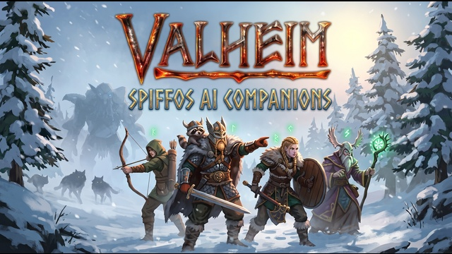

# Spiffo's Valheim AI Companions

[Español](README.es.md) · [Latest release](https://github.com/NotUrSpiffo/Spiffos-AI-Companions/releases/latest) · `main` is plugin `0.26.1`

<p>
  
</p>

Talk to Valheim companions in **English or Spanish**, by text or microphone, and give them ordinary-language jobs. The mod’s default AI service is the **Player2** desktop app. Offline Companions Reborn **1.5.8** is already inside `SpiffoAiCompanions.dll`, so you do not install that mod again.

This page describes settings and limits in this repository. It is not a gameplay test report. A [Player2 game page](https://player2.game/games/jorge-roman/game-f3f99636) has been submitted and was reported as under review. That page is not an approval.

<a id="contents"></a>

## Contents

- [Features](#features)
- [Five in a world, four in one order](#companions)
- [Quick start](#quick-start)
- [Requirements](#requirements)
- [Install](#install)
- [Player2 setup](#player2)
- [Voice](#voice)
- [Check that it is connected](#check)
- [Other AI providers](#other-providers)
- [Language](#language)
- [Controls](#controls)
- [Configuration](#config)
- [Troubleshooting](#troubleshooting)
- [Release](#release)
- [Credits](#credits)

<a id="features"></a>

## ✨ Features

| What you get | Where it is defined |
| --- | --- |
| Text chat with the companion you look at, or the closest one | `TalkKey` default `Y`; in-game chat when `TalkInGameChat` is on |
| Push-to-talk through the Player2 app | `[Voz]` default hold `H`, max 15 seconds |
| Up to 5 companions in one world | Fixed constant `MaxCompanionsPerWorld` in `BehaviorOverrides.cs`. Not a config key. See [companions](#companions) |
| A different job for each companion named in one order | At most 4 recipients (`Recipients.MaxPerOrder`). `AllowActions` default on |
| English and Spanish UI, prompts, and replies | `[Personaje] Language` default `Auto` |
| Memory between sessions | `[Memoria] Enabled` default on; stored unencrypted in the mod config folder |
| Short comments on bosses, biomes, deaths, raids, and similar events | `[Reacciones]` default on; each comment is an AI request |
| Optional autonomous mode for every companion | `/autonomy`; default mode is `Normal` (they only do what you ask) |
| Reborn movement, combat, and jobs inside this DLL | Reborn plugin version `1.5.8`; do not install a second copy |
| Works without AI for a few exact phrases | `come` / `follow me`, `stop`, `stay`, plus the slash commands below |

Six built-in personalities are in the character editor: **Old Guard**, **Rookie**, **Explorer**, **Hunter**, **Craftsman**, and **Joker**. If `[Personaje] Personality` is empty, each companion without custom instructions gets one of those profiles. Inclination choices in the editor are **Automatic**, **None**, **Craft**, **Exploration**, **Hunting**, and **Foraging**. Automatic follows the profile; it does not override an order you give.

On `main`, plugin **0.26.1** also changes these Reborn behaviors in `codigo/src/BehaviorOverrides.cs` and `codigo/src/SeatSync.cs`. What changed is in [RELEASE_NOTES.md](RELEASE_NOTES.md).

- **Mining:** a stone or ore rock, or a section of one, is skipped when the code decides it can only be reached by swimming. If `MHR_Water.WouldSwim` or `MHR_GatherRules.AllowTarget` is missing, the log warns that this skip is unavailable.
- **Fighting with a tool out:** if the chosen item is a fishing rod, has pickaxe damage, or is a tool, the mod tries a melee weapon, then a bow, and otherwise unequips that item. If the Reborn combat methods are missing, the log warns that the swap is unavailable.
- **Stuck at work (0.25.7):** if a chopping or mining companion goes **20** seconds without a swing, a hit, or moving more than 1.5 m, outside combat and while not catching its breath, the target is left for Reborn's blacklist time and it looks for another. The log gets a `[Recoger]` line with what was in its hand and whether it was attacking, on the ground, swimming, or seated.
- **Companion limit (0.25.7):** a world holds at most **5** (`MaxCompanionsPerWorld`), a fixed constant, not a config entry. One order still addresses at most **4**. See [companions](#companions).
- **Stone without a pickaxe (0.25.8):** an order for stone picks up loose stones when the companion has no pickaxe, even though Reborn stops collecting them once there is a bronze-or-better axe or a forge. With a pickaxe it mines rocks.
- **Walking while seated (0.25.8):** every 0.5 s each loaded companion is checked; one that moves between 0.8 and 15 m/s for 1.5 s while its animation is seated is stood up, unless it is on a ship. The game that runs it stands it up for everyone; other games only on their own screen. The log gets a `[Sentado]` line.

<a id="multiplayer"></a>

## 🌍 Multiplayer (0.26.0)

- **Shared speech:** with `[Multijugador] ShareSpeech = true` (the default), what your companions say is sent to the other players. Their game shows it as a bubble over the companion and as a chat line, only if they have this mod and are within Valheim's normal chat talking distance (`Talker.m_normalDistance`, the range of a player talking normally). Players further away see nothing. What you type to your companion is not sent, and neither are the mod's notices. The setting is per player: it decides whether your companions' speech is shared. `codigo/src/SharedSpeech.cs`.
- **Other players:** each request to the AI lists the other players within **60** m of the companion, up to **5**: name, distance, whether they are badly hurt, and what they hold in their hands. Their inventory stays in their game, so it is not included. The companion recognizes them and can talk about them, but only takes orders from its own player. `codigo/src/GameContext.cs`.

<a id="therzie"></a>

## 🛡️ Therzie's mods (0.26.1)

These changes only take effect when [Warfare](https://thunderstore.io/c/valheim/p/Therzie/Warfare/), [Monstrum](https://thunderstore.io/c/valheim/p/Therzie/Monstrum/) or [Armory](https://thunderstore.io/c/valheim/p/Therzie/Armory/) are loaded. Without them, the item list, places and reactions are the same as in 0.26.0.

- **Gather orders:** `gather` also accepts **10** pelts and meats from Therzie's prey (fox, razorback, black and grizzly bear, rotting elk and lox), only if the game has that item loaded. The name is the one the game shows, with Therzie's translation. Drops from monsters that are not hunted, such as troll bone or prowler fang, are not on the list. `codigo/src/CompanionActions.cs`.
- **Skills:** asking about a companion's skills also lists skills added by other mods, such as Warfare's throwing skill. `codigo/src/CompanionBridge.cs`.
- **Places:** while exploring, the altars of Asmodeus, Svält and Vrykolathas and the vegvisirs that point to them are named. `codigo/src/OrderPlanning.cs`.
- **Mini-bosses:** defeating Asmodeus, Svält or Vrykolathas gets a comment and a memory, like a boss. They leave no world key, so it counts when one that was within **60** m and below **35 %** health dies or disappears. `codigo/src/WorldEvents.cs`.

Combat, hunting, mining, repairs and the too-strong check already read the game's own data, so Warfare weapons and Monstrum creatures go through the same rules as the base game's.

The Spanish texts of the mod now use neutral Spanish.

<a id="companions"></a>

## 👥 Five in a world, four in one order

A world holds at most **5** companions. One order addresses at most **4** of the ones nearby. Those numbers are not the same limit. Inside an order you can still give different tasks, for example `Bjorn, chop wood` and then `Astrid, fish`.

**Per world: 5, fixed.** `MaxCompanionsPerWorld` is the constant `5` in `codigo/src/BehaviorOverrides.cs`. It is not an entry in `SpiffoAiCompanions.cfg` or in the Reborn config. On the host, and in single player, the count adds:

- living companion objects (`HC_Companion` and Dverger variants)
- tombstones waiting to revive, when that id is not already counted alive
- roster entries marked unsummoned (dismissed)

A new companion is created only through `SpawnCompanion`: the free starter (`SpawnStarterCompanion`, default on), the Odin shrine offering (`CompanionPrice`, default **1000** coins), and a trader purchase. If the count is already 5, that call is refused. The center message is `You already have 5 companions in this world, the maximum.` The log line starts with `[Compañeros] No se crea otro`. Coins are removed only after spawn succeeds, so a refused summon does not take the offering. Coming back from a tombstone, or calling back someone already unsummoned, does not go through `SpawnCompanion`, so this check does not refuse them. A guest is not the server, so the count falls back to `CompanionSetup.AllCompanions`: the companions loaded near them. That fallback does not add the unsummoned roster. If `SpawnCompanion` cannot be patched, the log says this limit is unavailable.

**Per order: 4.** `Recipients.MaxPerOrder` is 4 in `codigo/src/OrderPlanning.cs`. It only chooses who one spoken order includes.

- **One person:** `Bjorn, chop wood` is for Bjorn. With no name, the order is only for the companion you are talking to (the one you look at, or the closest within talk range).
- **A list:** names separated by commas, still at most 4 in that order. A fifth name in the same order is not added.
- **The group:** `everyone`, `all`, `team`, `guys`, or `everybody` (and `todos`, `todas`, `equipo`, `chicos`) selects up to 4 nearby companions, including the one who is answering.
- **Separate jobs:** another message gives someone else a different task. That is still the order cap of 4, not a fifth body in the world.

**Not this 5.** Each companion keeps at most **5** pending tasks (`OrderSequence.MaxQueued`). One more returns `Has too many pending tasks.` One message applies at most **6** actions (`MaxActionsPerMessage`). Further actions in that reply return `Not applied: too many orders at once.`

The cover shows four illustrated figures. It is promotional art, not the world limit. Companions in an unloaded zone cannot hear you. `/recall` names them and tells you to walk closer. It does not spend AI credits.

`/autonomy` switches **all** companions between normal mode and autonomous mode. Autonomous mode can spend credits up to `MaxPerHour` (default 30) initiatives an hour.

<a id="quick-start"></a>

## ⚡ Quick start

1. Valheim already has [BepInEx](https://thunderstore.io/c/valheim/p/denikson/BepInExPack_Valheim/). If it does, leave that install in place.
2. Copy only `SpiffoAiCompanions.dll` into `BepInEx/plugins/`. Do not add a separate Offline Companions Reborn plugin.
3. Install and open the [Player2](https://player2.game) app. Leave `[IA] Provider` at `Player2` and leave `ApiKey` empty.
4. Start Valheim. In chat, `/balance` should answer with your Player2 joules.

The playable package is the [latest release](https://github.com/NotUrSpiffo/Spiffos-AI-Companions/releases/latest). Inside that zip the DLL is under `install/BepInEx/plugins/`, and the sample configs are under `configuration examples/`. In this git tree the same DLL path is still [`instalar/BepInEx/plugins/SpiffoAiCompanions.dll`](instalar/BepInEx/plugins/SpiffoAiCompanions.dll). The source constant on `main` is plugin **0.26.1**. The published zip can lag behind that tree; use the latest release page, not an older checksum copied here.

<a id="requirements"></a>

## Requirements

- Valheim with BepInEx. The pack linked above is the one this guide points at. If BepInEx is already installed, do not replace its files.
- For the intended setup: the Player2 desktop app, running on the same PC, before you launch the game.
- Voice always needs that app, even if chat uses another provider.
- Ollama, LM Studio, or another OpenAI-compatible API can replace **chat** only. See [Other AI providers](#other-providers).

<a id="install"></a>

## 📦 Install

Do this with Valheim closed.

1. **BepInEx, once.** If `BepInEx` is not already in the Valheim folder, install [BepInExPack for Valheim](https://thunderstore.io/c/valheim/p/denikson/BepInExPack_Valheim/) using that pack’s own instructions. If it is already there, do not copy the pack over `winhttp.dll`, the doorstop files, or the existing `BepInEx` folder.
2. **This mod only.** From the release zip, or from [`instalar/BepInEx/plugins/`](instalar/BepInEx/plugins/), copy `SpiffoAiCompanions.dll` into `Valheim/BepInEx/plugins/`. If that DLL is already there and you are updating this same mod, replace **that file only**.
3. **Do not install Reborn beside it.** Movement and jobs come from Reborn 1.5.8 inside this DLL. Do not also install `Offline Companions Reborn`, `Companions.dll`, or an older `OfflineCompanionsAI.dll`. If another copy is loaded, the mod stops and logs: `Mod desactivado: hay otra copia de Offline Companions Reborn en <path>. Este mod ya la lleva dentro: borra ese archivo con Valheim cerrado.`
4. **Spanish Reborn menus, optional.** Copy the `Translations` folder from [`instalar/BepInEx/plugins/OfflineCompanionsReborn/Translations/`](instalar/BepInEx/plugins/OfflineCompanionsReborn/Translations/) to `BepInEx/plugins/OfflineCompanionsReborn/`. That folder is only the Spanish `Spanish.json` files. It does not replace the DLL. The mod’s own language setting does not need this copy.
5. **Config.** On first launch BepInEx creates `BepInEx/config/SpiffoAiCompanions.cfg` (the project is built with `NEW_INSTALL`, plugin GUID `SpiffoAiCompanions`). A reference file with the same defaults is [`configuracion/SpiffoAiCompanions.cfg`](configuracion/SpiffoAiCompanions.cfg). If you already changed your config, do not overwrite it with the sample.

Reborn’s own file, `BepInEx/config/Maddhattr.OfflineCompanionsReborn.cfg`, is separate. A reference copy is [`configuracion/Maddhattr.OfflineCompanionsReborn.cfg`](configuracion/Maddhattr.OfflineCompanionsReborn.cfg). You do not need to edit it for Player2. Do not replace it if you have already changed shrine price, keys, or jobs.

<a id="player2"></a>

## 🎮 Player2 setup

Player2 is the provider this mod is written to use. Chat goes to the Player2 app on your machine. You do not put a model name or an API key in the config for that setup.

Official Player2 pages used for the steps **outside** this mod:

- Download the app from [player2.game](https://player2.game).
- Player2’s own posts say to keep the desktop app open, that this local use does not ask you to paste an API key, and that API docs are at `http://localhost:4315/docs` while the app is running: [building AI NPCs](https://blog.player2.game/p/building-ai-npcs-with-player2-api), [introducing the app](https://blog.player2.game/p/we-are-sharing-2m-revenue-with-1000).

This repository does not name Player2’s sign-in screen or microphone screen. If the app asks you to sign in, do that in the app before you start Valheim.

### Settings that match Player2

In `BepInEx/config/SpiffoAiCompanions.cfg` the defaults are already the Player2 setup. The sample file’s `ApiKey` is empty on purpose. It is not a key you should fill in from this README, and this repository does not ship a Player2 secret.

```ini
[IA]
Provider = Player2
BaseUrl =
Model =
ApiKey =

[Voz]
Enabled = true
VoiceKey = H
MaxSeconds = 15
BaseUrl = http://localhost:4315/v1
```

What the code does with those fields:

| Setting | Player2 behavior |
| --- | --- |
| `[IA] Provider = Player2` | Chat is `POST http://localhost:4315/v1/chat/completions`. |
| `[IA] BaseUrl` | Ignored for Player2. Used only when `Provider = Custom`. |
| `[IA] Model` | Ignored. The request omits `model`. The config text says Player2 picks the model. |
| `[IA] ApiKey` | Leave empty. If it is not empty, the mod also sends `Authorization: Bearer` with that value. The file stores it in plain text. Do not share the file after you add one. |
| `[Voz] BaseUrl` | Microphone and `/balance`. Default `http://localhost:4315/v1`. |
| Health check | While the provider is Player2, `GET http://localhost:4315/v1/health` every **60** seconds. |

Port **4315** is the local Player2 port this mod calls. Chat with `Provider = Player2` stays on `http://localhost:4315/v1` even if you change `[Voz] BaseUrl`. Change the voice URL only when the app is actually listening on another address. Ollama and LM Studio ports below are for those providers, not for Player2.

The mod sends its own `player2-game-key` header. You do not copy that value into `ApiKey`.

<a id="voice"></a>

## 🎙️ Voice

Voice is off only if `[Voz] Enabled = false`. Otherwise:

1. Player2 is open. The mod’s config text says the microphone and the speech-recognition language are selected in that app.
2. In Valheim, **hold** `VoiceKey` (default `H`), speak, and **release**.
3. The mod calls `POST {Voice BaseUrl}/stt/start` with a timeout of `MaxSeconds` (default **15**, allowed **3–60**), then `POST .../stt/stop` when you release. It stops slightly before the app’s own timer (`StopMargin` 0.5 s).
4. Voice uses the Player2 app even when `[IA] Provider` is `Ollama`, `LMStudio`, or `Custom`.

Each voice message can spend Player2 balance. `/balance` itself does not.

<a id="check"></a>

## ✅ Check that it is connected

These are the messages the mod prints. They are not a scripted playtest.

1. Open Player2, then start Valheim.
2. In `BepInEx/LogOutput.log`, a good load contains `Conectado con Offline Companions Reborn. Proveedor: Player2`.
3. In the game chat box, type `/balance` or `/saldo`. The mod reads `{Voice BaseUrl}/joules`. Success looks like `Player2 balance: <number> joules`. If the app does not answer: `Could not check Player2 balance.`
4. Press `Y`, or type in the game chat with `Enter`. The addressed companion shows `<name> is thinking...` while the request runs. Default talk distance is **80** m (`TalkRange`, allowed 2–100).
5. Hold `H` and release. If the app is closed, voice says: `Could not connect to Player2 for voice recognition. Check that the app is open.`

<a id="other-providers"></a>

## Other AI providers

`[IA] Provider` accepts `Player2`, `Ollama`, `LMStudio`, and `Custom`.

| Provider | Chat URL the mod uses | Model field |
| --- | --- | --- |
| `Player2` | `http://localhost:4315/v1` | omitted |
| `Ollama` | `http://localhost:11434/v1` | required; the config example is `llama3.2` |
| `LMStudio` | `http://localhost:1234/v1` | required for most setups |
| `Custom` | `[IA] BaseUrl`, including `/v1` | required for most services |

```ini
[IA]
Provider = Ollama
Model = llama3.2
```

Orders are sent as OpenAI-style `tools` with `tool_choice` `auto`. A model that never returns tool calls will not carry out free-form jobs. Exact phrases still run without a model reply: `follow me`, `come here`, `stop`, `stay`, and the Spanish lines in `OrderIntent` (`ven`, `para`, `quedate`, and the other entries in that list), including `everyone` or a companion’s name in front. Voice still needs Player2.

`TimeoutSeconds` default **30** (5–180). `Temperature` default **0.8** (0–2). `MaxTokens` default **0** means no limit. A low limit can make the reply empty; the game then says to raise it or set it to 0.

<a id="language"></a>

## 🌐 Language

`[Personaje] Language` default **`Auto`**. The source comment says Auto follows Valheim’s English, Español (Latinoamérica), or Español (España). In code, any Spanish game language selects the mod’s one Spanish mode; it is not a separate third UI. You can set `English` or `Spanish` without restarting.

- Chat: `/language en`, `/language es`, `/language auto` (`/lang`, `/idioma`). With no argument it switches between English and Spanish.
- Character editor: hold `LeftShift` and press `Y`, or type `/character` (`/personaje`) while a companion is the target. The buttons are `English`, `Español`, and `Auto (Game)`.
- Both English and Spanish slash commands work either way.

`ReplyLanguage` default `auto` follows that setting. Item names are matched across English and both Spanish vocabularies. One synonym group in `ItemNames` is `seta` / `hongo` / `mushroom`.

<a id="controls"></a>

## 🕹️ Controls

Defaults. Change the key fields if these clash with another mod. `TalkKey` cannot be `T`: the config text says Valheim uses `T` for emotes.

| Action | Default |
| --- | --- |
| Talk to who you look at, or the closest companion | `Y`, or Valheim chat (`Enter`) if `TalkInGameChat` is true |
| Shout farther | `/s` plus the message, up to `ShoutRange` (default **120** m, allowed 20–300) |
| Voice | Hold `H`, release to send |
| Character sheet | `LeftShift` + `Y`, or `/character` |
| Help, status, call everyone, balance | `/help`, `/status`, `/recall` or `/call`, `/balance` |
| Autonomous mode for every companion | `/autonomy` |
| Named places | `/mark <name>`, `/places`, `/forget <name>` |
| Mod language | `/language en` · `es` · `auto` |
| Reborn: point at something | Tap `Z` (`DirectTargetKey`). Hold `Z` to call companions |
| Reborn: command wheel on one companion | Hold `E` while looking at them (`RadialMenuKey`) |
| Reborn: farm zone editor | Hold `LeftAlt` and press `Z` |

Spanish aliases: `/ayuda`, `/estado`, `/llamar`, `/saldo`, `/personaje`, `/autonomia`, `/lugares`, `/marcar`, `/olvidar`, `/idioma`.

`/help`, `/status`, `/recall`, `/balance`, `/autonomy`, `/places`, `/mark`, `/forget`, and `/language` do not go through the AI (`RunCommand`). `/character` needs a companion as the target; otherwise the game says none of yours is nearby.

With other players in the world, game chat is sent to the AI only if the message names a companion, so talk between players is not forwarded. `TalkInGameChat = false` turns game-chat listening off. The minimum gap between messages is `Cooldown` (default **2** seconds).

In-game `/help` prints the order examples. The same list includes lines such as `follow me`, `get 10 stone`, `Bjorn, chop wood`, and `everyone, follow me`. Emotes are skipped while an enemy is within **25** m, while the companion is working, resting, swimming, or otherwise not in a position to emote, and for **10** seconds after the previous emote. `AllowEmotes = false` turns that off. `AllowActions = false` stops conversation from applying jobs.

Reborn’s wheel is the full command wheel in this source (follow, job actions, set home, despawn, stances, and the other entries in `CompanionRadialMenu`). It is not reduced to four buttons. The despawn label in the English strings is `Despawn`.

<a id="config"></a>

## ⚙️ Configuration

`BepInEx/config/SpiffoAiCompanions.cfg`

| Section | What it controls |
| --- | --- |
| `IA` | Provider, and model / key / URL only when you are not on Player2 |
| `Voz` | Microphone on or off, hold key, max seconds, Player2 voice URL |
| `Conversacion` | Talk and edit keys, 80 m / 120 m ranges, chat echo, whether orders and emotes are allowed |
| `Personaje` | `Language`, `ReplyLanguage`, shared personality, `RebornSpeech`, reply length |
| `Memoria` | Save chat, and summarize older chat with an extra AI request |
| `Reacciones` | Event comments. Cooldown default **180** s (30–3600). `MaxPerHour` default **10** (1–60) |
| `Autonomia` | `Normal` or `Autonomo`. `IntervalSeconds` default **75** (20–3600). `MaxPerHour` default **30** (1–120) |
| `Multijugador` | `ShareSpeech` default `true`: other players with the mod see your companions' speech within normal chat distance. See [multiplayer](#multiplayer) |

`RebornSpeech` default `Avisos`: Reborn’s own lines are limited to warnings such as having no axe. `Todas` is the original Reborn chatter. `Ninguna` silences those fixed lines. The AI replies are separate.

Exploration orders use `ExploreGoal.TimeLimitSeconds` (**240** s) and stay within `ReachShare` (**0.85**) of the loaded area around you, so they are not given a fixed “85 m” cap in this source. Finds reported on that trip are capped at **8**, looked for within **50** m (`ExploreFindMeters`).

<a id="troubleshooting"></a>

## 🛠️ Troubleshooting

Text in the right-hand column is what the mod shows, or the check its own log tells you to make.

| What you see | What the source says to check |
| --- | --- |
| `Could not connect to the AI. Check that the service is running.` | Player2 (or the other provider) is not answering. Open the app, then try again. |
| `Could not check Player2 balance.` | `/balance` could not read `/joules`. Same app and `[Voz] BaseUrl`. |
| `The AI rejected authentication. Check your API key or session.` | HTTP 401 or 403. For Player2, sign in inside the app if it asks, and leave `ApiKey` empty unless you intend to send a bearer token. |
| `Your AI account does not have enough balance.` | The response body contained `insufficient_credits`. |
| `Too many requests to the AI. Wait a moment.` | HTTP 429. |
| `Could not connect to Player2 for voice recognition. Check that the app is open.` | Voice HTTP status 0. |
| `Player2 is already listening. Try again in a moment.` | Voice HTTP 409. |
| `Player2 voice recognition is unavailable. Check the microphone in the app.` | Voice HTTP 503. The mod does not name the app’s microphone control. |
| `Listening time expired. Please try again.` | Voice HTTP 404. |
| `The AI returned no text...` | Raise `MaxTokens` or set it to `0`. |
| They answer and do not act | `AllowActions` must be `true`. With `ShowOrdersInChat` on, applied orders are prefixed `Order for <name>:`. |
| `You already have 5 companions in this world, the maximum.` | `MaxCompanionsPerWorld` is already reached on this count: living companions, tombs waiting to revive, and unsummoned roster entries when you are the host. A new summon is refused and the offering is not taken. Reviving, or recalling someone already unsummoned, does not use that check. |
| `Has too many pending tasks.` | That companion already has 5 queued tasks. This is the task queue, not the world limit of 5 companions. |
| `Not applied: too many orders at once.` | That single reply tried to apply more than 6 actions. |
| `Mod desactivado: hay otra copia de Offline Companions Reborn` | Delete the other Reborn or old AI DLL with the game closed. Do not delete `SpiffoAiCompanions.dll`. |
| No `Conectado con Offline Companions Reborn` line | The plugin did not finish loading. Read the matching `Mod desactivado` line in `BepInEx/LogOutput.log`. |
| Nobody hears you | They are farther than `TalkRange` (80 m) or, for a shout, `ShoutRange` (120 m). The game states the distance. Unloaded zones need you to walk closer; `/recall` lists those names. |

Repair, smelting, and the other job tools still depend on Reborn: a tool in the pack or in a chest, a free slot, and the matching job enabled in `Maddhattr.OfflineCompanionsReborn.cfg`. This page does not add failure cases that are not in those files.

<a id="release"></a>

## 📥 Release

Download the current package from the [latest release](https://github.com/NotUrSpiffo/Spiffos-AI-Companions/releases/latest). The checksum file on that page matches the files published there. This page does not repeat an older package hash.

Notes in the repo: [RELEASE_NOTES.md](RELEASE_NOTES.md). [`SHA256SUMS`](SHA256SUMS) in this tree names the DLL committed here, which can be newer than the zip on the latest release.

<a id="credits"></a>

## Credits

Spiffo's Valheim AI Companions includes Offline Companions Reborn **1.5.8** by Maddhattr, based on Offline Companions by ProfMags, under the MIT license. The MIT text is [licenses/Offline-Companions-Reborn-MIT.txt](licenses/Offline-Companions-Reborn-MIT.txt) and [codigo/Reborn/LICENSE](codigo/Reborn/LICENSE). [THIRD_PARTY_NOTICES.txt](THIRD_PARTY_NOTICES.txt) states that this MIT grant covers that third-party component, not a license chosen here for Spiffo’s own source or DLL.

Spanish interface and speech files in the package were written by ROMAN, as that notice says. This mod is not affiliated with Maddhattr, ProfMags, Player2, or the makers of Valheim.

The cover image is promotional art supplied for this documentation. It is not a screenshot of a tested session and not an official Player2 or Valheim endorsement.
